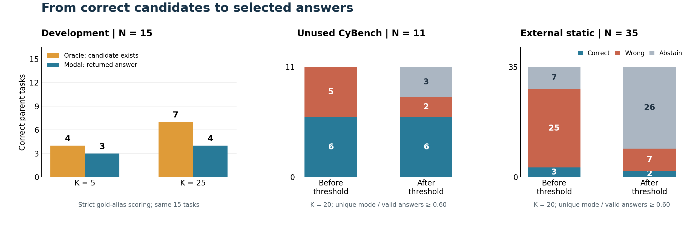

# Generation–Selection Gap in Cybersecurity Agents

**정답 후보 생성·최빈 답 선택·기권을 분리한 로컬 사이버보안 에이전트 평가**

[논문 PDF](CISC-W_2026_paper__324.pdf) · [프로젝트 소개서](docs/project-summary.ko.md) · [코드 안내](docs/code-guide.md) · [실험 방법·한계](docs/methodology.md) · [English](README.en.md)

## 어떤 문제를 다뤘나요?

LLM 에이전트를 여러 번 실행하면 정답 후보를 얻을 기회가 늘어납니다. 그러나 **정답이 후보 중에 존재하는 것**과 **시스템이 그 정답을 최종 답으로 선택하는 것**은 다릅니다. 가장 자주 나온 답이 틀릴 수 있고, 신뢰도가 낮은 답을 기권하는 과정에서 정답도 버릴 수 있습니다.

이 연구는 로컬 8B 모델의 읽기 전용 사이버보안 과제 실행을 기록하고, **후보 생성 → 최빈 답 선택 → 기권** 단계에서 보존하거나 잃은 정답을 각각 평가했습니다. 모델을 새로 학습한 연구가 아니라, 기존 모델·추론 엔진을 활용한 평가 파이프라인과 실패 분석 연구입니다.

## 핵심 결과

개발 15과제에서 반복 횟수를 5회에서 25회로 늘리자, 정답 후보가 존재하는 과제는 **4 → 7개**, 최빈 답으로 실제 맞힌 과제는 **3 → 4개**가 되었습니다. 후보 생성의 증가분이 최종 선택으로 모두 이어지지는 않았습니다.



왼쪽은 **정답 별칭 기준**의 동일 개발 과제 비교입니다. 오른쪽은 별도 K=20 평가의 정답·오답·기권 수이며, 개발 단계와 생성 설정·채점 대상이 다릅니다. 이 그림은 공개 설명을 위해 보존 수치로 새로 그렸습니다.

| 관찰 | 결과 | 의미 |
| --- | --- | --- |
| 개발 15과제, K=5 → 25 | Oracle 4/15 → 7/15, 최빈 답 3/15 → 4/15 | 정답 후보의 존재와 최종 선택을 별도로 평가해야 함 |
| MOTP 과제, K=50 | 오답 `!==` 49회, 정답 `==` 1회 | 높은 반복 빈도만으로 정답을 보장할 수 없음 |
| CyBench 미사용 11과제, K=20 | 6정답·2오답·3기권 | 고정 기권 규칙이 정답 6개를 보존하고 오답 3개를 추가 기권 |
| 외부 35과제, K=20 | 2정답·7오답·26기권; Oracle 3/35 | 정답 후보 부재와 기권에 따른 정답 손실도 확인 |

**Oracle**은 정답표로 후보 중 정답의 존재를 사후 확인하는 지표이며 실제 배포 선택기가 아닙니다. **최빈 답**은 정규화 문자열의 빈도로 선택합니다. **미사용**은 이 연구의 정책 선택에 쓰지 않았다는 뜻이며, 모델의 사전학습 미노출을 뜻하지 않습니다.

## 연구에서 다룬 업무

| 업무 | 구현·분석 내용 | 확인할 자료 |
| --- | --- | --- |
| 반복 평가 구성 | 시드별 대화·도구 상태 초기화, 호출·출력 예산, 실행 기록 저장 | [실행 코드](scripts/run_experiment.py) |
| 모델·도구 연결 | llama.cpp HTTP 연동, JSON 해석, 파일 접근 경계와 출력 제한 | [코드 안내](docs/code-guide.md) |
| 선택·신뢰도 평가 | 최빈 답, Oracle, 기권, 응답률·응답 오류율을 구분 | [방법과 지표](docs/methodology.md) |
| 실패 분석 | 높은 빈도의 오답, 정답 소수 후보, 무효 응답과 외부 이전 한계 분석 | [프로젝트 소개서](docs/project-summary.ko.md) |
| 검증과 전달 | 과제 단위 집계, 테스트, 원본 해시와 공개용 재집계 | [재현·검증 안내](docs/reproducibility.md) |

공동연구 자료입니다. 논문 저자와 개인별 구현 기여의 구분은 [인용·저자 정보](CITATION.md)와 [자료 출처](docs/provenance.md)를 참고하십시오.

## GPU 없이 결과 확인하기

Python **3.11 이상**, 추가 Python 패키지 없이 실행할 수 있습니다.

```bash
git clone https://github.com/SHINDAWIT/Generation-Selection-Gap-in-Cybersecurity-Agents.git
cd Generation-Selection-Gap-in-Cybersecurity-Agents
python3 -B scripts/verify_public_results.py
PYTHONPATH=src:. python3 -B -m unittest discover -s tests -v
```

공개용 검증 도구는 **1,670개 실행 기록의 투영 데이터**로 선택·기권 결과를 다시 집계하고, 파일 해시를 검사합니다. 답 문자열은 정규화 후 SHA-256 식별자로 바꾸고 과거 채점 라벨을 함께 보존했습니다. 원문 답의 정오를 독립적으로 재판정하거나 모델 추론을 재실행하는 검증은 아닙니다. [데이터 필드·검증 범위](docs/reproducibility.md)

## 실험 범위와 읽을 때의 주의점

- **한 모델**: IBM Granite 4.2 8B, Q4_K_M. RTX 5070, llama.cpp b11026을 사용했습니다.
- **정적 과제**: 파일 목록·읽기·문자열 추출·16진수 보기만 허용했습니다. 전체 대화형 CyBench 수행 능력을 측정한 결과로 해석하지 않습니다.
- **독립 과제 61개, 실행 1,670회**: 개발 15×50, 미사용 11×20, 외부 35×20입니다. K=25 분석은 개발 로그의 앞 25회를 재사용합니다.
- **채점 기준 구분**: 정답 별칭을 주 분석으로 사용합니다. 의미 엔트로피·의미 정오는 정답표를 본 단일 주석자의 사후 진단입니다. 두 기준의 수치를 합치지 않습니다.
- **코드 버전 구분**: 공개 코드는 현재 보존된 스냅샷입니다. 개발 로그의 prompt v1과 현재 실행기의 v2/v3, 과거 K=25 코드 해시 사이에 차이가 있습니다. [변경과 재현 한계](docs/provenance.md)

논문 제목: **사이버보안 에이전트의 반복 샘플링에서 정답 생성과 최빈 답 선택의 간극** / **The Gap Between Correct-Answer Generation and Modal Answer Selection in Multi-Rollout Cybersecurity Agents**.

[전체 결과와 분모](docs/results.md) · [자료 출처·공개 범위](docs/provenance.md) · [모델·벤치마크 출처](THIRD_PARTY_NOTICES.md)
