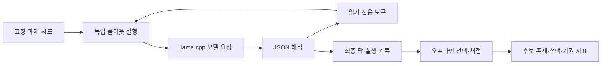

# 코드 안내

## 실행과 평가의 연결 관계

모델 호출과 최빈 답 선택은 정답을 이용하지 않습니다. 정답 별칭 대조와 Oracle 집계는 오프라인 평가 단계입니다. 코드에서 선택 결과에 정오를 부착하는 부분과 후보를 고르는 부분을 구분해 읽어야 합니다.

## 핵심 파일

| 파일 | 주요 역할 | 읽을 함수·경계 |
| --- | --- | --- |
| [scripts/run_experiment.py](../scripts/run_experiment.py) | 과제·시드 실행, 재개, 도구 출력 제한, JSONL 저장 | `run_rollout`, `bounded_tool_record`, `existing_keys`, `SYSTEM_PROMPT` |
| [src/cisc_rollout/client.py](../src/cisc_rollout/client.py) | 로컬 OpenAI 호환 HTTP 요청 | `chat_completion`, `_post_json`, `healthcheck` |
| [src/cisc_rollout/schema.py](../src/cisc_rollout/schema.py) | 실행 기록 자료형, JSON 추출, final·action 검증 | `Rollout`, `parse_turn`, `rollout_from_record` |
| [src/cisc_rollout/tools.py](../src/cisc_rollout/tools.py) | 허용 디렉터리의 파일만 읽는 도구 | `ReadOnlyToolset`, `_resolve` |
| [src/cisc_rollout/normalize.py](../src/cisc_rollout/normalize.py) | NFKC·공백·인용부호·대소문자 정규화 | `normalize_answer`, `answers_match` |
| [src/cisc_rollout/selectors.py](../src/cisc_rollout/selectors.py) | 개발 단계의 선택기 | `normalized_majority`, `agreement_abstention`, `oracle_pass_at_k` |
| [src/cisc_rollout/metrics.py](../src/cisc_rollout/metrics.py) | 과제 단위 집계와 부트스트랩 | `evaluate_tasks`, `bootstrap_percentile_ci` |

정규화는 의미를 교정하지 않습니다. `==`와 `!==`처럼 보안 질문의 정오를 바꾸는 내부 기호를 유지합니다. 모델이 제시한 인용문의 존재는 코드가 확인할 수 있지만, 그것만으로 주장과 근거의 논리적 타당성이 입증되는 것은 아닙니다.

## 단계별 분석기

| 파일 | 분석 대상 | 입력에 관한 조건 |
| --- | --- | --- |
| [analyze_k50.py](../scripts/analyze_k50.py) | 고정 시드 prefix의 strict Oracle 도달성, 형식 허용 민감도 | 원시 개발 로그·원본 K=5 로그 필요 |
| [analyze_k25.py](../scripts/analyze_k25.py) | 앞 25회의 선택·기권·비용·부트스트랩 | 원시 로그·준비 데이터·기록된 환경 필요 |
| [analyze_semantic_entropy.py](../scripts/analyze_semantic_entropy.py) | 사후 군집·엔트로피·정오 구분 | 원시 개발 로그·군집 주석 필요 |
| [analyze_holdout.py](../scripts/analyze_holdout.py) | K=20, 유효 답 지지율 0.60 정책 | 원시 로그·과제·정답 별칭 필요 |
| [analyze_external_transfer.py](../scripts/analyze_external_transfer.py) | 외부 정적 과제의 같은 정책 | 외부 준비 데이터·원시 로그·별도 정답표 필요 |

**개발 선택기는 동률을 가장 앞선 시드로 해소하지만, K=20 정책은 동률이면 기권합니다.** 개발 K=25의 기권 기준도 전체 25회 중 15회라는 절대 빈도이며, K=20의 유효 응답 대비 0.60 기준과 다릅니다.

원시 로그를 요구하는 분석기를 공개용 해시 기록에 바로 적용하지 않습니다. 공개 저장소만으로 실행하는 진입점은 아래 검증 도구입니다.

## 공개를 위해 추가한 코드

- [verify_public_results.py](../scripts/verify_public_results.py): 완전한 과제·시드 격자와 라벨 일관성 검사, 최빈 답·기권 재집계, 논문 수치 대응과 파일 해시 검사.
- [export_public_data.py](../scripts/export_public_data.py): 보존 연구 폴더에서 필요한 필드만 추리는 큐레이터용 도구. 원시 자료가 있는 환경에서만 사용하며 추론을 실행하지 않습니다.
- [test_public_verification.py](../tests/test_public_verification.py): 누락·중복 기록 거부, 같은 답의 라벨 불일치 거부, 동률·유효 답 분모·소수 정답 경계 검사.

이 코드는 공개를 위한 추가 작업입니다. 원 연구 당시 사용한 실행기나 새로운 선택기 성능 실험으로 표현하지 않습니다.

## 보존 코드와 개인 기여의 경계

연구 폴더의 선택된 소스와 테스트는 바이트를 유지한 스냅샷입니다. 파일별 원본 대응은 [publication_manifest.json](../publication_manifest.json)에 있습니다. 모델·추론 엔진·벤치마크는 기존 공개 도구를 사용했으며, 새로운 모델이나 벤치마크를 개발했다고 주장하지 않습니다. 개인별 함수 작성 범위는 현재 Git 게시 이력으로 소급해 입증하지 않습니다.
